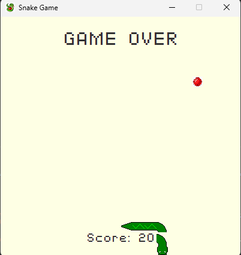

# Testing Record

## Direction validation — 4 November 2026

Branch: `fix/direction-validation`

Implementation:
`src/main/java/com/comp2042/GameController.java`

Tests:
`src/test/java/com/comp2042/GameControllerTest.java`

### Purpose

Prevent direct reversal into the snake's body while allowing
perpendicular turns and continued movement in the same direction.

### Automated checks

20 parameterised cases:

- Four opposite-direction requests are rejected.
- Eight perpendicular turns are accepted.
- Four same-direction requests are accepted.
- Four non-arrow keys are rejected as movement directions.

Command: `.\mvnw.cmd test`

Before the fix:
20 tests ran, with two failures and no errors.
Up-to-down was incorrectly accepted, and down-to-down was rejected.

Change:
The DOWN case now checks that the current direction is not UP.

After the fix:
Maven reported BUILD SUCCESS.

Tests run: 20, Failures: 0, Errors: 0, Skipped: 0, Time elapsed: 0.131 s -- in com.comp2042.GameControllerTest

### Manual checks

- Passed: rapid up/down inputs no longer cause the previously
  observed reversal into the snake's body.
- Passed: left/right reversal checks during gameplay.
- Passed: pause stops movement and an arrow key resumes gameplay.
- Passed: reset restarts the game successfully.

### Additional observations

- A visible gap between snake segments was captured in a screenshot
  at a bend on the game-over screen. Cause not yet established.
- Top-to-bottom border wrapping was observed. The existing blue-coin
  power-up enables this behaviour; whether it was active during that
  particular occurrence was not recorded.

### Limitations

These unit tests verify the direction-validation method.
They do not verify keyboard-event timing, rendering or collision
handling during actual gameplay.

## Snake rendering — 4 November 2026

Branch: `fix/snake-rendering`

### Changes

- Replaced stored corner history with sprite selection based on
  neighbouring snake positions.
- Removed turnArray and turnDir.
- Made the controller's movement direction instance-specific.
- Corrected double application of fullscreen scaling.
- Handled the duplicate head/body position during fatal blocked moves
  when preparing the drawing positions.

### Automated checks

Before renderer integration, all 42 tests passed:
20 direction-validation cases and 22 sprite-selection cases.

After renderer integration, `.\mvnw.cmd test` completed successfully:
42 tests run, 0 failures, 0 errors and 0 skipped.

Manual gameplay testing covered 10 rounds. The previously observed
snake-body gap did not recur during these runs.

`git diff --check` reported no whitespace errors.

### Manual checks

Played 10 rounds after integration. The previously observed body gaps
did not recur. A screenshot captures connected segments through
multiple bends on the game-over screen.

### Remaining verification

Explicit checks of border wrapping, fullscreen scaling, and
Esc → Start are still to be recorded if not covered during these rounds.

### Additional regression tests — 5 November 2026

Moved tail rotation and preparation of drawing positions into
SnakeSpriteSelector so these calculations can be tested directly.

Added 15 test cases covering:
- Tail rotation in all four directions, including wrapped borders.
- Rejection of invalid tail neighbours.
- Removal of the duplicate final head position after a blocked fatal move.
- Preservation of the original body list and interior self-collision positions.
- Living snakes and empty drawing lists.

Command: `.\mvnw.cmd clean test`

Result: BUILD SUCCESS.
57 tests run, 0 failures, 0 errors and 0 skipped:
20 direction-validation cases and 37 rendering-helper cases.

These tests check rendering calculations, not JavaFX visual output.
The earlier 10-round manual gameplay check found no recurrence
of the snake-body gap.

## Fullscreen controls — 5 November 2026

### Problem

The keyboard reported EQUALS when the fullscreen shortcut was pressed,
but the controller only accepted PLUS.

### Change

Fullscreen entry now accepts EQUALS, PLUS and ADD.
Returning to windowed mode accepts MINUS and SUBTRACT.

### Manual verification

- Passed: = enters fullscreen without requiring Shift.
- Passed: - returns to windowed mode.
- Passed: repeated switching between the two modes.
- Snake segments appeared connected in both modes.

Number-pad shortcuts have not been explicitly verified.
Dedicated automated key-mapping tests remain pending.

### Follow-up

Removed the temporary key-event diagnostic output left in PR #5.

## Snake collision state — 5 November 2026

Branch: `fix/snake-collision-state`

### Changes

Movement now checks the destination before changing the snake's
positions. Fatal moves preserve the last valid head, body and direction.
Movement requests after death leave the snake unchanged.

### Automated checks

Command: `.\mvnw.cmd clean test`

96 tests passed, with zero failures, errors or skipped tests:
- 20 direction-validation cases.
- 39 movement and collision cases.
- 37 sprite-selection cases.

### Manual checks

- Self-collision: game over triggered.
- Wall collision: game over triggered.
- Obstacle collision: game over triggered.
- Arrow keys after death: no movement or growth.
- Tab reset: a new round starts successfully.
- Snake remained visually connected in the captured collision cases.

### Remaining issues

- A pale square background is visible around the red coin.
- Obstacles can overlap the game-over title.

These visual issues remain outside this collision fix.

## Coin transparency — 5 November 2026

Branch: `fix/coin-transparency`

Updated the blue, gold, rainbow, red and silver coin PNGs to remove
their opaque backgrounds.

Manual verification:
- The red coin displays without the pale square during gameplay.
- Other coin colours remain pending visual verification.

No Java code changed.

## Coin collection audio — 5 November 2026

Branch: `fix/coin-audio`

### Cause and change

The bundled `coinSound.wav` existed, but GameController did not load or
play it. Unused Media/MediaPlayer imports and a sound path remained.

CoinSound now loads the resource through a classpath URL and reuses one
AudioClip per controller. Successful collection triggers playback before
the win check. Tab reset retains this sound object. Missing resources and
synchronous loading/playback failures disable audio with a diagnostic
instead of interrupting gameplay. Asynchronous device failures may still
be reported by the JavaFX media system.

### Automated verification

Five new CoinSoundTest cases cover:
- A readable, non-empty bundled WAV resource.
- One load and one playback request per call, including repeated calls.
- Missing resource handling.
- Loading failure handling.
- Playback failure handling without repeated attempts or diagnostics.

Assistant verification: all 101 tests passed using an ECJ compiler with
Java 17 and JavaFX 17. This was not the project's configured Maven stack.
The tests use replacement playback callbacks; they do not establish
that sound is audible or that controller events fire correctly in-game.

Windows Maven verification: 101 tests passed with zero failures, errors or skips during the coin audio fix.

### Pending manual checks

- Collect several coins: one audible sound for each successful collection.
- Collect available power-up coins: the same collection sound plays.
- Ordinary movement and collisions do not trigger collection audio.
- Tab reset, then collect again: audio still works.
- Escape to the menu, start again and collect: audio still works.
- Check the console for audio errors and confirm gameplay remains responsive.

## Obstacle spawning — 10 November 2026

The first placement fix passed all 106 tests on Windows. In gameplay the silver coin still produced a crowded wave, and obstacles overlapped the game-over label.

The revised generator shuffles available cells and places at most one block in each board quarter, up to four total. It keeps the outer columns, top three rows and bottom two rows clear. The minimum straight-line distance from the head and between blocks is four grid cells. A crowded board can receive fewer blocks. The win target uses the actual count added.

Revised suite: 106 tests passed with Java 17 and JavaFX 17. The revised placement cases cover 100 standard layouts, a rectangular board with an existing block, and a board with no suitable cells. Windows Maven and visual verification of this revision are pending.

Manual check: collect a silver coin, inspect spacing and label clearance in windowed and fullscreen modes, then press Tab and verify the obstacles clear.

## Coin selection — 10 November 2026

Playtesting confirmed the revised obstacle spacing felt right. A separate round reached 130 points without a reported silver coin. Previously silver depended on a random draw and became ineligible while obstacles existed. Rainbow shared the same draw as gold and was unreachable.

CoinSequenceTest checks the contents of 20 consecutive groups and verifies that resetting during a group restarts the silver countdown. The original red coin is placed before the sequence begins. Windows verification of repeat silver and rainbow pickups is pending.

## Repeat silver pickups — 10 November 2026

Playtesting found that a second silver pickup gave points but left the four blocks in the same positions. Later pickups now relocate one block when a safe cell is available. The other three stay in place on a full wave. If relocation is impossible, the existing layout is preserved. The win target changes only for additional blocks.

Two regression cases check repeated relocation and the no-space fallback. Windows gameplay check pending: compare layouts before and after collecting a second silver, then reset with Tab.
